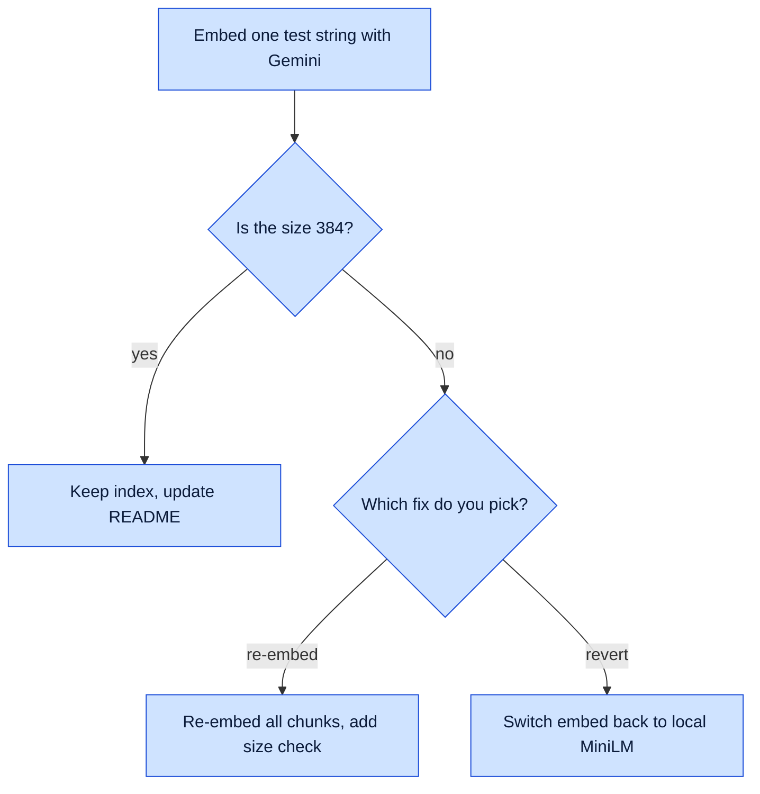
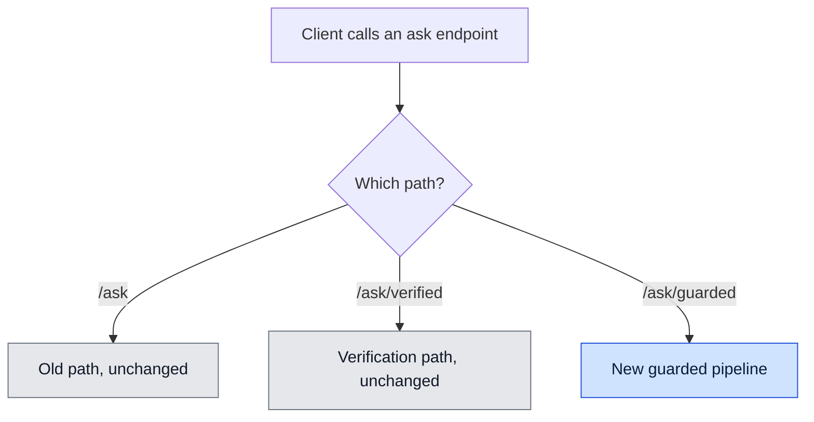
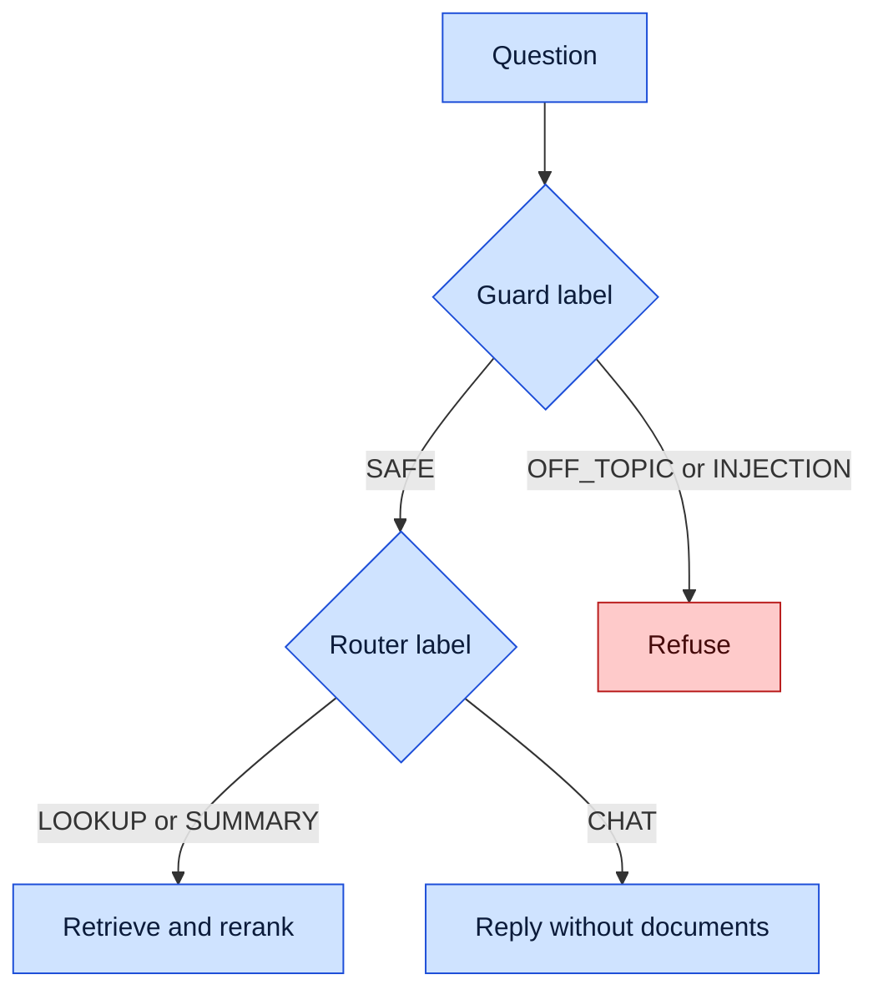
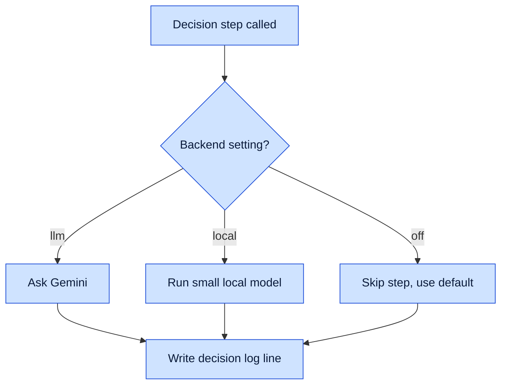
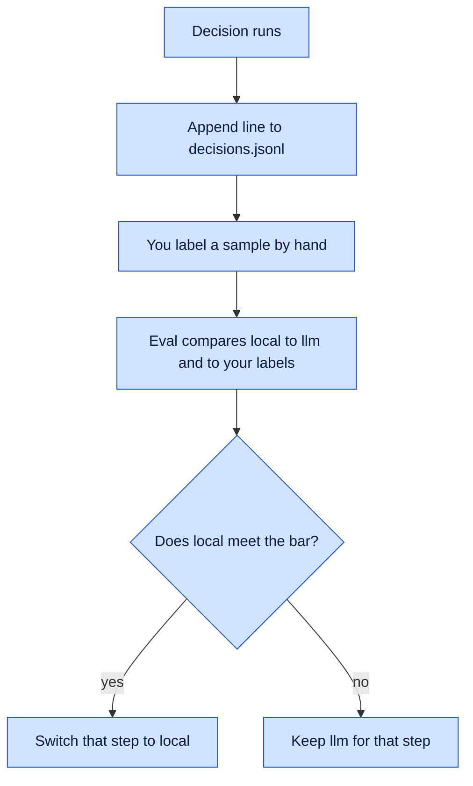
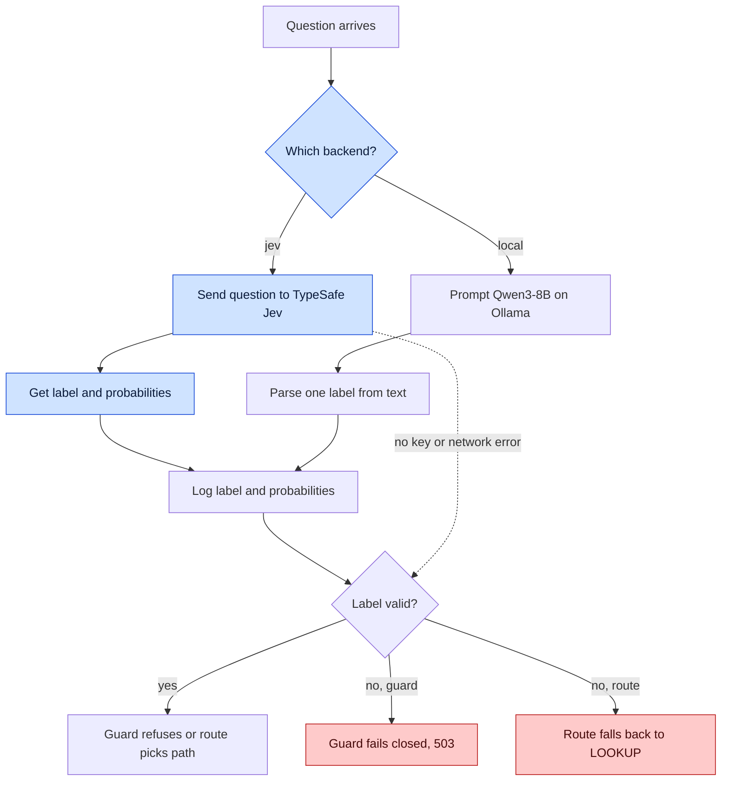

# Architecture Decision Records

Status: DRAFT for review. Each ADR lists what it gives up.

Explainer for all five ADRs: [docs/visuals/guarded-pipeline.html](visuals/guarded-pipeline.html)

---

## ADR-1: Fix the embedding dimension mismatch before anything else

### Visual Level

Blue boxes are all new. This is a one-time check followed by one fix. Linked explainer: [guarded-pipeline.html](visuals/guarded-pipeline.html).

**Context.** The index holds 371 vectors of 384 dimensions. The code embeds queries with Gemini `embedding-001`. I expect 768 dimensions, so search would fail. This is untested.

**Options.**
- A. Re-embed all documents with Gemini. Add a dimension check when the index loads.
- B. Switch `embed()` back to local MiniLM (`all-MiniLM-L6-v2`). The index stays valid. README becomes true again.
- C. Keep both and store the model name in the index metadata.

**Choice.** A, with the size check. Recommendation, not final. You decide.

**Consequences.** One Gemini embedding call per chunk to rebuild (371 calls). The index metadata records the embed model name. A mismatch fails at load with a clear message, not deep in NumPy.

**Outcome (2026-11-16).** Done with option A. Measured facts that changed the plan: `models/embedding-001` returned 404 (retired), so the old code could not embed at all. The replacement is `models/gemini-embedding-001` at 768 dimensions. Its truncated vectors are not unit length (norm 0.57), so `embed()` now normalizes. The old index is saved in `lite_index/backup_384/`. The chat model `models/gemini-2.0-flash` is also retired and is not fixed yet. Free-tier quota is 100 embedded texts per minute.

**Given up.** Fully offline embeddings (the README claim). Gemini embeddings cost money and need the network. B keeps offline but adds PyTorch to the server, which conflicts with ADR-4's memory concern.

---

## ADR-2: Add `/ask/guarded` as a new endpoint

### Visual Level

Grey is unchanged. Blue is new. Linked explainer: [guarded-pipeline.html](visuals/guarded-pipeline.html).

**Context.** The React UI calls `/ask`. A change there affects every user.

**Options.** A. Change `/ask`. B. New endpoint. C. Feature flag on `/ask`.

**Choice.** B.

**Consequences.** Old behavior stays safe. The UI needs one URL change to try the new path. We can compare the two paths on the same question.

**Given up.** Two code paths to maintain. `/ask` stays unguarded until we choose to switch.

---

## ADR-3: Three decision steps with closed label sets

### Visual Level

Linked explainer: [guarded-pipeline.html](visuals/guarded-pipeline.html).

**Context.** The audit found the only closed-choice LLM call in the repo is a YES/NO check in `/ask/verified`. The user wants routing, reranking and a guardrail.

**Options.** Free-text decisions (hard to test). Closed labels (easy to score, easy to replace with a small model).

**Choice.** Closed labels.
- Guard: `SAFE`, `OFF_TOPIC`, `INJECTION`.
- Route: `LOOKUP` (k=5 after rerank), `SUMMARY` (k=12 after rerank), `CHAT` (no retrieval).
- Rerank: score per chunk, keep top N where N comes from the route.
- Score floor: a constant on the reranked score. Below it, return "not found".

An unparseable guard label is an error (fail closed, see architecture Open Question 4). An unparseable route label becomes `LOOKUP`.

**Consequences.** Each step can be scored against labeled data. Each step can move to a small model later.

**Outcome (2026-11-16).** Built on the `llm` backend only (`decisions.py`, `SimpleRAG.ask_guarded`, `/ask/guarded`). Rerank is not wired. Live check: lookup, summary and chat questions route correctly, and the off-topic question was refused. The free-tier Gemini chat quota returned 429 on some guard calls, so those requests failed closed with 503. The decision log now stores an `error` field to show this. Guard and route add two LLM calls per question, which makes this quota a real ceiling and is the case for a local model in ADR-4.

**Given up.** Nuance. A question can be both a lookup and a summary. The router picks one. The label sets are my guess and may need change after the first eval.

---

## ADR-4: Each step has a swappable backend (`llm`, `local`, `off`)

### Visual Level

Linked explainer: [guarded-pipeline.html](visuals/guarded-pipeline.html).

**Context.** The experiment asks whether a System 1 model can replace the LLM in a decision step. The code needs to run both on the same input.

**Options.**
- A. Env var per step (`GUARD_BACKEND`, `ROUTE_BACKEND`, `RERANK_BACKEND`). A dict maps name to function.
- B. Class hierarchy with an abstract base. Rejected: one implementation per backend does not need it.
- C. Run `local` only offline in the eval script, never in the server.

**Choice.** A. Candidate System 1 models, to confirm in the eval:
- All three steps: the Qwen3-8B model you already have, run by Ollama (`qwen3:8b`) and called over HTTP. The first eval ran on a separate GGUF file under `llama-server`. That copy is deleted. No new model download and no PyTorch.
- Dropped options: a MiniLM cross-encoder for rerank and MiniLM example-sentence matching for guard and route. They need about 1.3 GB of extra packages and models. You asked for a light app.

**Consequences.** Switching backend is a config change. Memory on Render may block `local` in the server (Open Question 2). If it does, fall back to C.

**Outcome (2026-11-16).** Built with Qwen as the `local` backend. See [system1_comparison.md](system1_comparison.md). Qwen scored 100% on guard and 96.7% on route (n=30 each, labels written by me), at about 0.5 s per call. Qwen rerank was worse than cosine order (MRR 0.751 against 0.844) and took 17 s per question. Keep `RERANK_BACKEND=off`. The Gemini side did not run because of the free-tier quota, so the with-and-without comparison is open.

**Given up.** Simplicity of one backend. About 5 GB of RAM while Ollama holds the model. A hard dependency on a local Ollama server for the `local` backend. The server must run on the same machine, so `local` does not fit a small Render instance.

---

## ADR-5: Log every decision and gate `local` on an agreement eval

### Visual Level

Linked explainer: [guarded-pipeline.html](visuals/guarded-pipeline.html).

**Context.** No labels exist. Trusting LLM output as truth is a known risk (your rule: calibrate LLM judges).

**Options.** A. Log decisions and hand-label a sample. B. Treat the LLM as ground truth. C. No eval, ship on feel.

**Choice.** A. The log line holds question hash, question text, label, backend, latency ms and a timestamp. The eval script reads the log plus a hand-labeled file. It reports accuracy, per-label recall, and agreement between `local` and `llm`. The bar is proposed as: `local` matches your labels at least as well as `llm`, with INJECTION recall at 95% or higher. You confirm the bar.

**Consequences.** Labeling takes your time (about 100 questions per step). The log stores user questions on disk. Add `logs/` to `.gitignore`.

**Outcome (2026-11-16).** The eval script and 72 labels exist (`tests/eval_decisions.py`, `tests/labels.jsonl`). I wrote the labels, so you must review them before you trust the bar. The Gemini run failed on quota, so no switch decision is made.

**Given up.** Speed to ship. Privacy of question text in the log. A small eval set gives wide error bars, and the report will say so.

## ADR-6: Add `jev`, a trained System 1 model, as a guard and route backend

### Visual Level

Blue is new. Red is a failure path. The `local` steps are unchanged. Jev returns a label and a probability for each label, so the log keeps the confidence. Level 3 explainer: skipped, because this chart shows every step and both failure paths that the change touches.

**Context.** ADR-4 used Qwen3-8B as the System 1 model. Qwen is a generative model. We prompt it to write one label, so it is a stand-in. Jev from TypeSafe AI is not generative. It returns typed answers with probabilities.

**Options.** A. Keep Qwen only. B. Add `jev` as a third backend for guard and route. C. Train our own classifier on embeddings.

**Choice.** B. `jev_choice()` in `decisions.py` makes one HTTP call with `httpx` to `POST https://api.typesafe.ai/v1/systemone`. It sends the question as `state` and one Choice question with the same labels as the prompt. The key is `TYPESAFE_API_KEY`. The model is `jev-latest`, or `JEV_MODEL`. Failures follow ADR-3: guard fails closed, route falls back to LOOKUP. Rerank does not allow `jev`, because it is not a closed choice. We did not pick C, because we have only 72 labels, and I wrote them.

**Consequences.** Each guarded question sends its text to TypeSafe. The log now holds probabilities, so we can test a threshold later. The listed price is $0.042 per million input tokens. Rate limits are in the console and are not measured.

**Default (2026-11-18).** Guard and route default to `jev` when `TYPESAFE_API_KEY` is set, and to `llm` when it is not. An explicit `GUARD_BACKEND` or `ROUTE_BACKEND` always wins. The cost: setting a Jev key also sends every question to TypeSafe, unless you pin the backend.

**Outcome (2026-11-17).** Guard on all 96 test questions: 0 wrong, mean 177 ms. See `docs/writeup.md`.

**Given up.** Question privacy (the text leaves the machine). An outside service that can fail or change. A vendor key. The offline use that Qwen gave.
