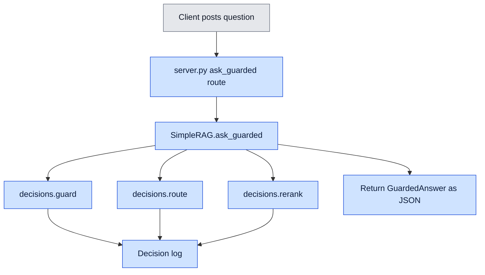

# API Contracts

Status: DRAFT for review. Python 3.9+ type hints. `dataclasses`, no Pydantic beyond the request model that `server.py` already uses.

## Visual Level



Blue is new. Grey exists today. The chart shows who calls whom. Every decision function writes to the log.

## HTTP

### `POST /ask/guarded`

Request body (same model as `/ask`):

```json
{"question": "string, 1 to 2000 characters"}
```

Success, HTTP 200:

```json
{
  "answer": "string",
  "refused": null,
  "found": true,
  "sources": [{"source": "file.pdf", "chunk_id": 3, "score": 0.81}],
  "trace": [
    {"step": "guard",  "backend": "llm",   "label": "SAFE",   "latency_ms": 410, "fallback": false},
    {"step": "route",  "backend": "local", "label": "LOOKUP", "latency_ms": 9,   "fallback": false},
    {"step": "rerank", "backend": "local", "label": null,     "latency_ms": 38,  "fallback": false}
  ]
}
```

Invariants:
- `refused` is `null`, `"OFF_TOPIC"` or `"INJECTION"`.
- If `refused` is not null, `sources` is empty and `found` is false.
- If route is `CHAT`, `sources` is empty and `found` is true.
- `trace` has one entry per step that ran, in order.

Errors:

| Code | Body | When |
|---|---|---|
| 400 | `{"detail": "Question is empty or too long"}` | Empty, whitespace only, or over 2000 characters |
| 502 | `{"detail": "Upstream model call failed"}` | Embedding or answer call failed |
| 503 | `{"detail": "Guardrail unavailable"}` | Guard backend error or unknown label |

`/ask`, `/ask/verified`, `/upload` and `/` do not change.

## Python

```python
# decisions.py
from dataclasses import dataclass
from typing import Callable, Optional

GUARD_LABELS = ("SAFE", "OFF_TOPIC", "INJECTION")
ROUTE_LABELS = ("LOOKUP", "SUMMARY", "CHAT")

@dataclass
class Decision:
    step: str            # "guard" | "route" | "rerank"
    backend: str         # "llm" | "local" | "off"
    label: Optional[str] # None for rerank
    latency_ms: int
    fallback: bool       # True if the default was used after an error

def guard(question: str, llm: Callable[[str], str]) -> Decision: ...
def route(question: str, llm: Callable[[str], str]) -> Decision: ...

def rerank(
    question: str,
    chunks: list[dict],      # each has "text", "source", "chunk_id", "score"
    top_n: int,
    llm: Callable[[str], str],
) -> tuple[list[dict], Decision]: ...
```

`llm` is a function that sends one prompt to Gemini and returns text. The caller passes `self.chat_model.generate_content(...).text`. This keeps `decisions.py` free of the `genai` import.

Invariants:
- `guard` returns a label in `GUARD_LABELS` or raises `GuardUnavailable`.
- `route` returns a label in `ROUTE_LABELS`. It never raises. On error it returns `LOOKUP` with `fallback=True`.
- `rerank` returns at most `top_n` chunks, sorted by new score descending, each with `score` replaced by the rerank score and `cosine` holding the old one. On error it returns the first `top_n` input chunks and `fallback=True`.
- Every call appends one line to `logs/decisions.jsonl`. A log failure never raises.

```python
class GuardUnavailable(Exception): ...
```

```python
# rag_simple.py (additions)
class SimpleRAG:
    def retrieve(self, question: str, k: int = 5) -> list[dict]: ...   # existing
    def ask_guarded(self, question: str) -> dict: ...                  # new, returns the JSON above
```

## Configuration (environment)

| Variable | Values | Default |
|---|---|---|
| `GUARD_BACKEND` | `llm`, `local` | `llm` |
| `ROUTE_BACKEND` | `llm`, `local`, `off` | `llm` |
| `RERANK_BACKEND` | `llm`, `local`, `off` | `off` |
| `SCORE_FLOOR` | float | set from the eval, `0.0` until then |
| `DECISION_LOG` | path | `logs/decisions.jsonl` |

`off` for guard is not allowed. A guardrail that is off is not a guardrail. `off` for route means always `LOOKUP`. `off` for rerank means cosine order.

## Eval script

```
python tests/eval_decisions.py --log logs/decisions.jsonl --labels tests/labels.jsonl
```

Label file line: `{"step": "guard", "question": "...", "label": "SAFE"}`.

Output: a table per step with accuracy, per-label recall, `local` versus `llm` agreement, median latency per backend, and estimated cost per 1000 calls. The script prints the sample size and says when it is below 100.

## Open Questions

1. Is a 2000 character limit right? I picked it. Chunks are 800 characters.
2. Should `trace` be returned to the client or only logged? This draft returns it so the UI can show it. It exposes backend names.
