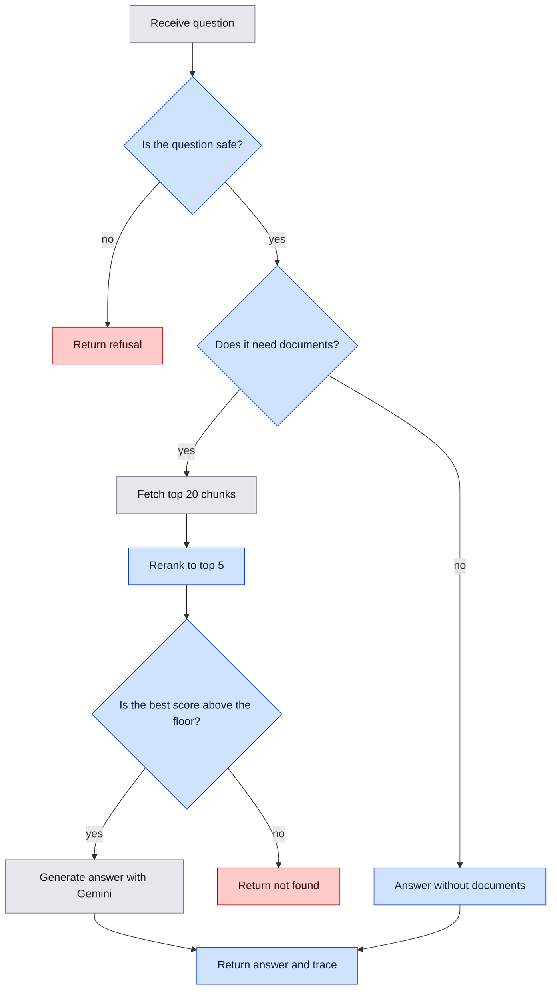

# Architecture: Guarded Ask Pipeline

Status: DRAFT for review. No implementation code exists yet.

## Visual Level

Blue boxes are new. Grey boxes exist today (`/ask` already fetches and generates). Red boxes are failure paths that stop the request. The new `/ask/guarded` endpoint adds three decisions around the existing fetch and generate steps: guardrail, router and reranker.

## Complexity tier

**Single-process tool.** One FastAPI process. One NumPy index on local disk. Calls to Gemini over HTTPS. No queue, no database, no second service.

The problem does not need more. The three new steps are plain functions in the same process. Any larger tier (for example a separate model-serving service for the small models) is more than the problem needs. See Open Questions for the Render memory limit that may force a change.

## What a "decision step" is

A decision step takes text and returns one label from a closed list. The guardrail returns `SAFE`, `OFF_TOPIC` or `INJECTION`. The router returns `LOOKUP`, `SUMMARY` or `CHAT`. The reranker is the same idea applied to a list: it scores each chunk and keeps the best ones.

Today the project makes no such decision before it answers. Every question gets the same path.

## System 1 and System 2

System 2 means slow, general reasoning. Here that is Gemini. System 1 means fast, narrow pattern matching. Here that is a small local model (tens of millions of parameters) that does one job.

Each decision step has two backends. The `llm` backend asks Gemini. The `local` backend runs the System 1 model. A third value, `off`, skips the step. The backend is set per step with an environment variable. This lets us run the experiment: same step, same inputs, two backends, then compare label, latency and cost.

## Components

| Component | File | Role | New or existing |
|---|---|---|---|
| `LiteVectorStore` | `rag_simple.py` | Cosine search over `lite_index/` | Existing |
| `SimpleRAG.retrieve` | `rag_simple.py` | Embed question, search | Existing, gains a `k` argument use |
| `guard`, `route`, `rerank` | `decisions.py` | The three decision steps with backend dispatch | New |
| `SimpleRAG.ask_guarded` | `rag_simple.py` | Runs the pipeline | New |
| `/ask/guarded` | `server.py` | HTTP entry | New |
| Decision log | `logs/decisions.jsonl` | One line per decision. Source of labels. | New |
| Eval script | `tests/eval_decisions.py` | Compare `local` against `llm` on a labeled set | New |

`/ask` and `/ask/verified` do not change.

## Data flow

1. The client posts a question.
2. `guard` labels it. Any label except `SAFE` ends the request.
3. `route` labels it. `CHAT` skips retrieval.
4. `retrieve` embeds the question and returns the top 20 chunks by cosine score.
5. `rerank` rescores the 20 chunks and keeps the top 5.
6. If the best reranked score is below the floor, the request ends with "not found". This is a cheap guard against answering from irrelevant text.
7. Gemini answers from the 5 chunks.
8. The response includes a `trace` with each label, backend and latency.

Every `guard`, `route` and `rerank` call appends one line to the decision log.

## Deployment shape

Same as today: one Render web service. The local models add weight to the image and to RAM. This is the main risk. See Open Questions.

## Tradeoffs

The pipeline adds latency before the answer starts. With the `llm` backend, it adds up to two Gemini calls (guard, route) plus one for rerank if reranking by LLM. With the `local` backend, the added time should be tens of milliseconds, but this is a claim to test, not a fact. The experiment exists to measure it.

## Open Questions

1. **Embedding dimension mismatch (blocks everything).** `lite_index/vectors.npy` has shape `(371, 384)`, which matches MiniLM. `rag_simple.py:124` embeds with Gemini `models/embedding-001`, which I expect returns 768 dimensions. If so, `np.dot` in `LiteVectorStore.search` raises a shape error on every query, and `upsert` raises on `np.vstack`. I have not run it. README says embeddings are local MiniLM, so README and code disagree. See ADR-1.
2. **Render memory limit.** The file comment says "Render-safe". A cross-encoder reranker normally needs PyTorch, which may not fit a free-tier instance. Options: ONNX runtime, a larger instance, or run System 1 only offline in the eval. You must choose. See ADR-4.
3. **No labels exist.** The eval needs about 100 labeled questions per step. ADR-5 proposes how to get them.
4. **Failure policy for the guardrail.** If the guard backend errors, should the request fail closed (503) or fail open (continue)? This draft chooses fail closed. Confirm.
5. **Dirty working tree.** `rag_simple.py` and `server.py` hold uncommitted changes (`ask_verified`). The new work builds on them. Decide whether to commit them first.
6. **Prior audit claim.** The pasted audit says RAG_mini has no routing, reranking or guardrail. The code confirms this for `/ask`.
