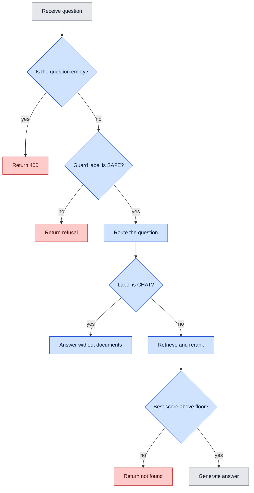

# Logic Flow: `/ask/guarded`

Status: DRAFT for review.

## Visual Level



Blue is new. Grey exists today. Red is a failure path. The chart omits upstream errors (embed or Gemini failure). The text below covers them.

## Happy path (document question)

1. `server.py` receives `POST /ask/guarded` with `{"question": str}`.
2. `SimpleRAG.ask_guarded` calls `guard(question)`. The label is `SAFE`.
3. It calls `route(question)`. The label is `LOOKUP` or `SUMMARY`.
4. It calls `retrieve(question, k=20)`. This embeds the question once, then does a cosine search.
5. It calls `rerank(question, chunks, top_n)`. `top_n` is 5 for `LOOKUP`, 12 for `SUMMARY`.
6. It checks the best reranked score against `SCORE_FLOOR`.
7. It builds the same prompt as `ask()` and calls Gemini once.
8. It returns the answer and the trace.

## Branches

| Condition | Result |
|---|---|
| Empty or whitespace question | HTTP 400 |
| Guard label `OFF_TOPIC` | HTTP 200, `answer` is a fixed refusal, `refused: "OFF_TOPIC"` |
| Guard label `INJECTION` | HTTP 200, fixed refusal, `refused: "INJECTION"` |
| Route label `CHAT` | No retrieval. Gemini answers with no context. Fixed system prompt. |
| Index empty | Same as `ask()`: "No relevant information found..." |
| Best score below floor | HTTP 200, "not found" answer, `refused: null`, `found: false` |

## Failure and retry behavior

| Failure | Behavior |
|---|---|
| Guard backend errors (Gemini timeout, model load error) | Fail closed. HTTP 503. No retry in the server. The client may retry. |
| Route backend errors | Default to `LOOKUP`. Log `fallback: true`. |
| Route returns an unknown label | Default to `LOOKUP`. Log `fallback: true`. |
| Guard returns an unknown label | Fail closed. HTTP 503. |
| Rerank backend errors | Use the cosine order, keep the top N. Log `fallback: true`. |
| Embedding call fails | HTTP 502. Same as today (the error propagates). |
| Final Gemini call fails | HTTP 502. Same as today. |
| Decision log write fails | Ignore. Print one line to stderr. The request continues. |
| Embedding size does not match the index | Raise at startup (ADR-1). The server does not start. |

Retries: the server does not retry. Today's `/ask` has none either. (README claims retries and an extractive fallback. The code in `rag_simple.py` has neither. See Open Questions.)

## State

The pipeline holds no state between requests. The only state is the index on disk, `meta.json` and the append-only decision log.

## Decision log line

One JSON object per line in `logs/decisions.jsonl`:

```json
{"ts": "2026-11-16T10:00:00Z", "step": "guard", "backend": "llm",
 "question": "...", "label": "SAFE", "latency_ms": 412, "fallback": false}
```

For `rerank`, `label` is replaced by `scores` (list of floats) and `kept` (list of chunk ids).

## Eval flow

1. Run the server with all three backends set to `llm` for a day, or run the script over a question file. This fills the log.
2. You label a sample in `tests/labels.jsonl`.
3. `tests/eval_decisions.py` re-runs each logged question through the `local` backend.
4. It prints accuracy against your labels, per-label recall, `local` versus `llm` agreement, median latency and estimated cost for each backend.
5. You decide which step moves to `local`.

## Open Questions

1. README claims "prompt budgets + retries + extractive fallback". `rag_simple.py` has none of these. Treat the README as stale. Confirm.
2. What is the score floor? Rerank now keeps the cosine score, so the floor stays on the cosine scale. The default is 0.0 (off). Pick it from the eval, not now.
3. Should `CHAT` call Gemini at all? A fixed greeting may be enough. This draft calls Gemini, so the route step has a visible effect.
