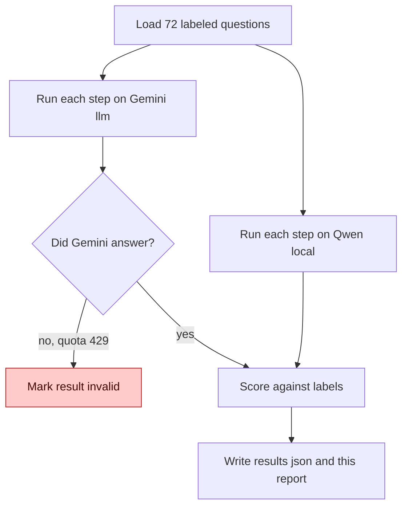

# System 1 comparison: with and without

Run date: 2026-11-16. Raw data: `docs/system1_results.json`. Script: `tests/eval_decisions.py`.

## Visual Level

Red is the failure path. The Gemini run failed on most calls, so only the Qwen result and the rerank `off` baseline are valid. The comparison is not finished.

## Answer first

Qwen3-8B works as a guard and as a router on this label set. It scored 100% on guard and 96.7% on route. Each call took about 0.5 seconds.

The Gemini side did not run. The free-tier quota failed 23 of 30 guard calls and all 30 route calls. The route fell back to LOOKUP each time. So there is no valid "without System 1" number for guard or route yet. Do not read the Gemini columns below as Gemini quality.

Qwen as a reranker is worse than doing nothing. It lowered MRR and precision, and it took 17 seconds per question.

## Results

| Step | Backend | n | Accuracy | Median ms | Valid |
|---|---|---|---|---|---|
| Guard | local (Qwen) | 30 | 1.00 | 529 | yes |
| Guard | llm (Gemini) | 30 | 0.23 | not measured | no, 23 errors |
| Route | local (Qwen) | 30 | 0.97 | 459 | yes |
| Route | llm (Gemini) | 30 | 0.33 | not measured | no, all fell back |

Qwen route made one error. It labeled one SUMMARY question as LOOKUP. Qwen guard recall was 100% for SAFE, OFF_TOPIC and INJECTION.

| Rerank backend | MRR | hit@5 | precision@5 | Median ms | Valid |
|---|---|---|---|---|---|
| off (cosine order) | 0.844 | 0.833 | 0.833 | 0 | yes |
| local (Qwen) | 0.751 | 0.833 | 0.683 | 17,428 | yes |
| llm (Gemini) | 0.844 | 0.833 | 0.833 | n/a | no, 11 of 12 fell back to cosine |

The Gemini rerank row equals the `off` row because 11 of 12 calls fell back to cosine order.

## Cost and memory

Qwen needs about 5.0 GB of RAM while the server runs. It needs no network and has no per-call fee. A guard call sends about 104 tokens. A route call sends about 73. A rerank call sends about 1,944.

I did not compute dollar costs. Gemini token counts are not valid because most calls failed.

## What this means

For guard and route, local Qwen is a credible System 1 on this small set. It is fast. It also removes two Gemini calls per question, which matters because the free-tier chat quota is the real ceiling of the guarded path.

For rerank, do not use Qwen. Keep `RERANK_BACKEND=off`. Cosine order is already as good as any valid result here.

The memory cost is high for a "light" app. A 1B to 2B Qwen model would use about 1 GB. I did not test one.

## Caveats

1. The Gemini result is invalid. Rerun it after the quota resets, or on a paid key.
2. I wrote the labels. A human has not reviewed `tests/labels.jsonl`. Qwen's 100% guard score may reflect easy labels.
3. The sample is small. 30 questions per classifier gives wide error bars. One error moves accuracy by 3.3 points.
4. The rerank corpus has squashed text and duplicate chunks. Cosine order is already strong, so the room to improve is small.
5. The eval does not measure final answer quality, only decision quality.
6. Token counts are an estimate (4 characters per token).

## Next steps

1. You review `tests/labels.jsonl`.
2. Rerun the Gemini side when the quota allows. The script resumes cleanly: run `python tests/eval_decisions.py` with Ollama running and `LOCAL_LLM_MODEL=qwen3:8b` set.
3. Optionally test a smaller Qwen model.
